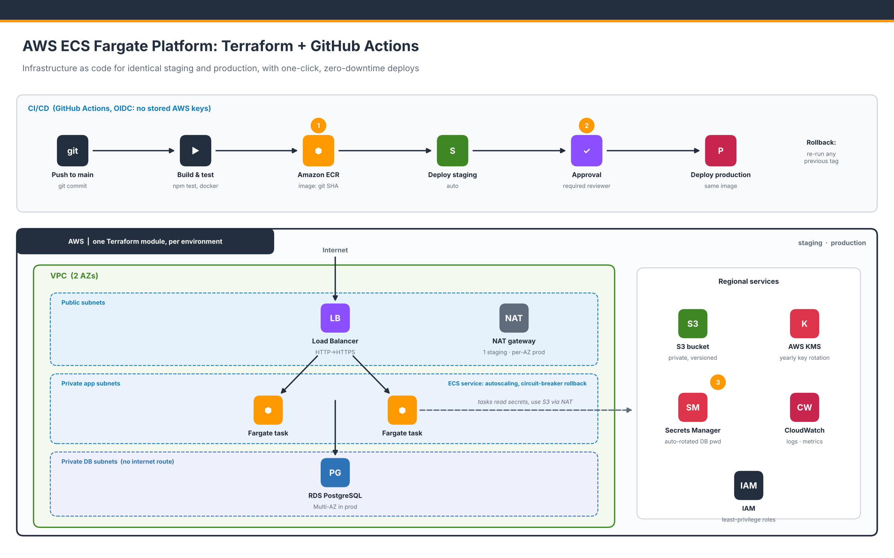

# AWS ECS Fargate Platform: Terraform + GitHub Actions

Production-style AWS platform for a containerised web service, built entirely as code.

- **Terraform** creates the full stack: VPC, Application Load Balancer, ECS Fargate, RDS PostgreSQL, S3 and KMS.
- **Staging and production run identical Terraform code**; they differ only in size and redundancy settings.
- **GitHub Actions** builds one Docker image per commit, deploys it to staging, then promotes the same image to production after approval.
- **No AWS keys are stored in GitHub.** Pipelines use short-lived credentials through GitHub OIDC.
- **Any engineer can deploy or roll back production in under 15 minutes** from the GitHub UI.



## What's inside

| Area | Implementation |
|---|---|
| Network | VPC across 2 AZs with public, private-app and private-DB subnets. NAT: one in staging, one per AZ in production |
| Compute | ECS Fargate behind an ALB. Rolling zero-downtime deploys, automatic rollback (circuit breaker), CPU autoscaling |
| Database | RDS PostgreSQL 16, encrypted with KMS, TLS enforced, Multi-AZ and deletion protection in production |
| Secrets | The DB master password is generated by RDS, stored in Secrets Manager and **rotated automatically**. The app re-reads it after rotation |
| Storage | Private S3 bucket: KMS-encrypted, versioned, TLS-only, public access blocked |
| Encryption | Customer-managed KMS key per environment with automatic key rotation |
| Network security | Security groups chained internet → ALB → app → DB. The database subnets have no internet route |
| CI | Every pull request: app tests, Docker build, `terraform fmt`, `terraform validate`, and a check that staging and production code are identical |
| CD | Push to `main` → build → staging → manual approval → production. Manual workflow for rollbacks |
| State | Remote state in S3 with native locking (no DynamoDB needed) |

## Repository layout

```
app/                       Node.js service (/health, /, /db) and Dockerfile
infra/
  bootstrap/               One-time: state bucket, ECR, GitHub OIDC + deploy roles
  modules/
    network/               VPC, subnets, routing, NAT
    service/               ALB, ECS cluster/service/task definition, IAM, autoscaling
    database/              RDS PostgreSQL
    storage/               S3 bucket
    stack/                 One full environment (composes the modules above)
  envs/
    staging/               main.tf + variables.tf (identical) + terraform.tfvars
    production/            main.tf + variables.tf (identical) + terraform.tfvars
.github/workflows/
  ci.yml                   Pull request checks
  deploy.yml               Build and promote staging -> production, manual rollback
  deploy-ecs.yml           Reusable ECS deploy job
docs/RUNBOOK.md            Day-to-day operations
Makefile                   Shortcuts for engineers
```

## Getting started

**Prerequisites:** an AWS account, AWS CLI v2 logged in, Terraform ≥ 1.10, Docker, Node.js 22, GitHub CLI (`gh`).

### 1. Lock dependencies (first time only)

```bash
cd app && npm install && cd ..
git add app/package-lock.json
```

### 2. Bootstrap the AWS account

```bash
make bootstrap GITHUB_REPO=<your-github-user>/aws-ecs-fargate-terraform-cicd
```

This creates the Terraform state bucket, the ECR repository and the GitHub OIDC roles.

### 3. Configure GitHub

1. In **Settings → Environments**, create `staging` and `production`.
   On `production`, add yourself under **Required reviewers**.
2. Run the commands printed by:

   ```bash
   terraform -chdir=infra/bootstrap output -raw github_setup_commands
   ```

### 4. Push the first image and create the environments

```bash
make first-image                # the image ECS starts with
make plan ENV=staging && make apply ENV=staging
make plan ENV=production && make apply ENV=production
make outputs ENV=staging        # shows the app URL
```

### 5. Deploy

Push to `main`. The **Deploy** workflow builds the image, deploys staging, waits for approval, then deploys production.

```bash
curl http://<alb-dns>/       # {"service":"sample-saas","environment":"staging","version":"<git sha>"}
curl http://<alb-dns>/db     # {"database":"ok","postgres":"16.x"}
```

## Deploying and rolling back

| Task | How | Time |
|---|---|---|
| Deploy a change | Merge to `main`, then approve the production step | ~10 min |
| Roll back | Actions → **Deploy** → Run workflow → pick environment and a previous image tag | ~5 min |
| Change infrastructure | Edit Terraform, open a PR (CI checks it), then `make plan` / `make apply` per environment | varies |

See [docs/RUNBOOK.md](docs/RUNBOOK.md) for details and troubleshooting.

## Design decisions

- **One module, two environments.** `infra/modules/stack` is the only definition of an environment. CI fails if `envs/staging` and `envs/production` code differs, so drift between them is caught at review time.
- **Build once, promote.** Production always receives the exact image that passed staging, identified by git SHA. ECR tags are immutable.
- **Clear ownership of the running image.** Terraform owns the infrastructure and the task definition settings. GitHub Actions owns which image is running: it copies the latest task definition and only changes the image. The ECS service ignores `task_definition` changes in Terraform for this reason.
- **Least privilege.** Each GitHub environment has its own IAM role that can only update its own ECS service. The app's task role can read only its own secret, bucket and KMS key.
- **No passwords anywhere in code, state or CI.** RDS manages and rotates the database password in Secrets Manager.

## Cost and cleanup

This creates billable resources. NAT gateways, the load balancer and RDS are charged hourly, and production runs more of them. Destroy everything when you are done:

```bash
make destroy ENV=staging
# production: set protect_data = false in its terraform.tfvars, apply, then destroy
make destroy ENV=production
```

Then delete the ECR images and run `terraform destroy` in `infra/bootstrap` (set `allow_destroy = true` first).

## License

MIT
